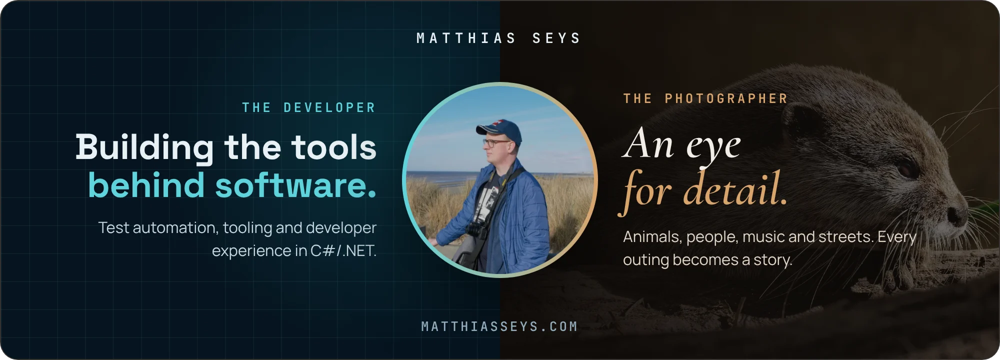
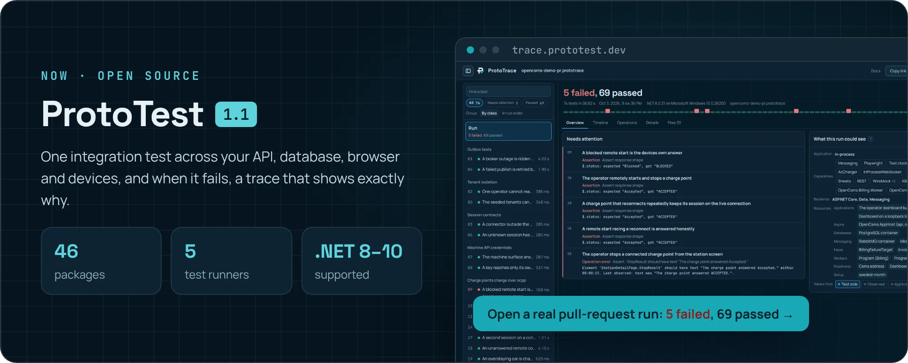
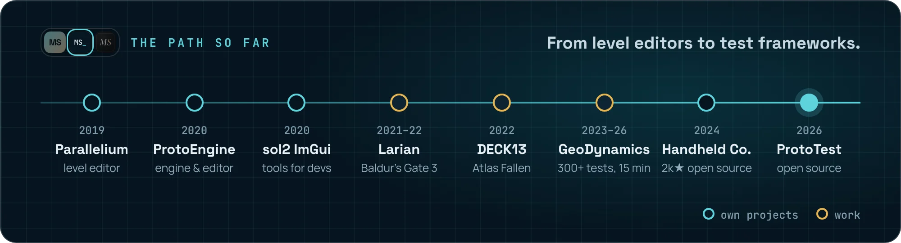
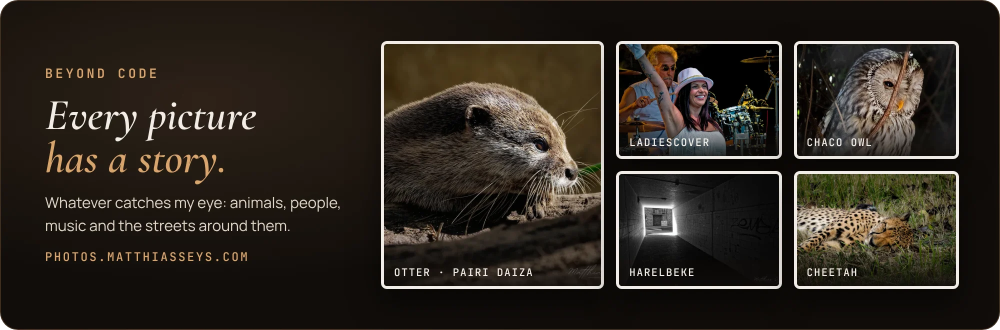

  <b>Test Automation Engineer · Quality &amp; Developer Experience</b> · Kortrijk region, Belgium 
  Open to roles in test architecture, automation and tooling · hybrid

  <a href="mailto:hello@matthiasseys.com">Email</a> &nbsp;·&nbsp;
  <a href="https://www.linkedin.com/in/matthias-seys/">LinkedIn</a> &nbsp;·&nbsp;
  <a href="https://cv.matthiasseys.com">CV</a> &nbsp;·&nbsp;
  <a href="https://dev.matthiasseys.com">Portfolio</a>

I build the tools behind software: test infrastructure, developer tooling and the foundations that make complex systems easier to understand, verify and ship. At GeoDynamics I designed and built the .NET test framework the team tests with: **300+ tests in about 15 minutes after every deployment**, where the regression used to take a week by hand. Before that I built editor and engine tools credited on *Baldur's Gate 3* and *Atlas Fallen*.

## Now

**[ProtoTest](https://prototest.dev)** lets one integration test cross your API, database, browser and devices, and when it fails, the trace shows exactly why. It runs inside NUnit, xUnit, MSTest or TUnit, so a team keeps the runner it has. 

[Docs](https://prototest.dev) · [GitHub](https://github.com/MSeys/ProtoTest) · [Open a real pull-request run](https://trace.prototest.dev/?trace=https%3A%2F%2Fraw.githubusercontent.com%2FMSeys%2FMSeys%2Fmain%2Ftraces%2Fopencsms-demo-pr.prototrace) · [The framework that came before it](https://dev.matthiasseys.com/projects/geodynamics-test-framework/)

## The path so far

[Parallelium](https://dev.matthiasseys.com/projects/parallelium/) · [ProtoEngine](https://dev.matthiasseys.com/projects/protoengine/) · [sol2 ImGui Bindings](https://dev.matthiasseys.com/projects/sol2-imgui-bindings/) · [Larian and DECK13](https://dev.matthiasseys.com/#career) · [GeoDynamics](https://dev.matthiasseys.com/projects/geodynamics-test-framework/) · [Handheld Companion](https://github.com/Valkirie/HandheldCompanion), where I led the move to MVVM and guided other contributors through it · [ProtoTest](https://dev.matthiasseys.com/projects/prototest/)

## Writing

<!-- BLOG-POST-LIST:START -->
- [Why nobody trusts their integration tests](https://prototest.dev/blog/why-nobody-trusts-their-integration-tests/)
- [Why ProtoTest 1.0 shipped too early](https://prototest.dev/blog/why-1-0-shipped-too-early/)<!-- BLOG-POST-LIST:END -->

## Beyond code

